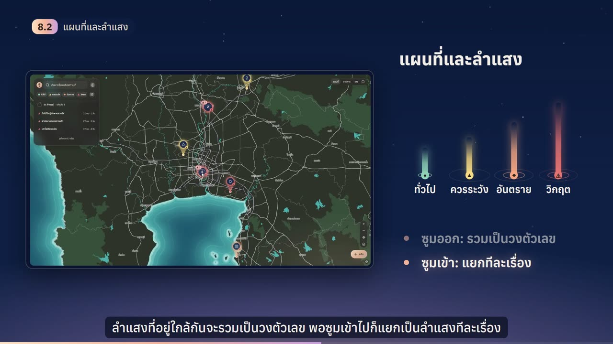
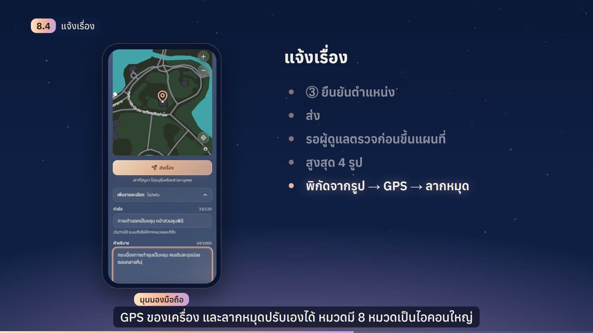
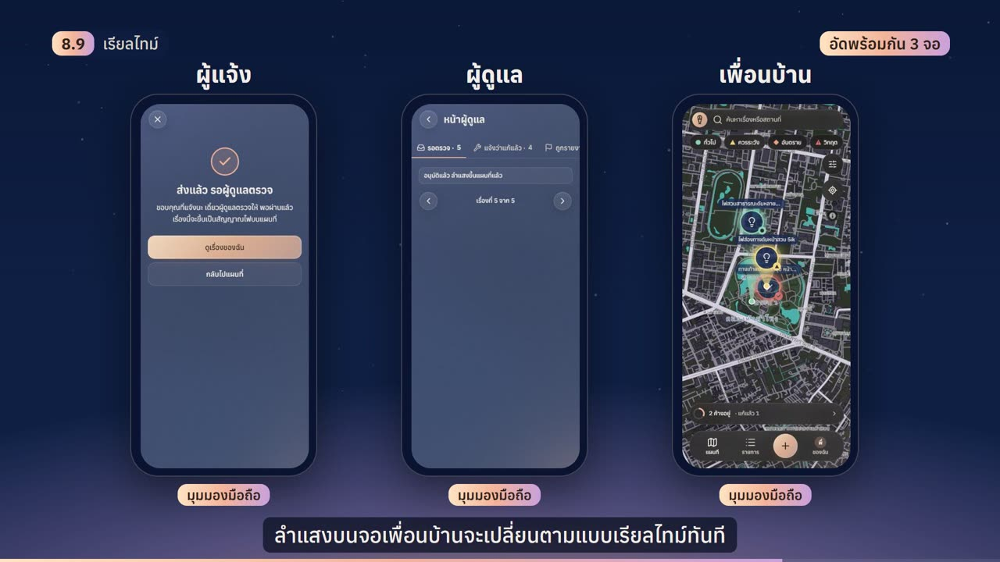
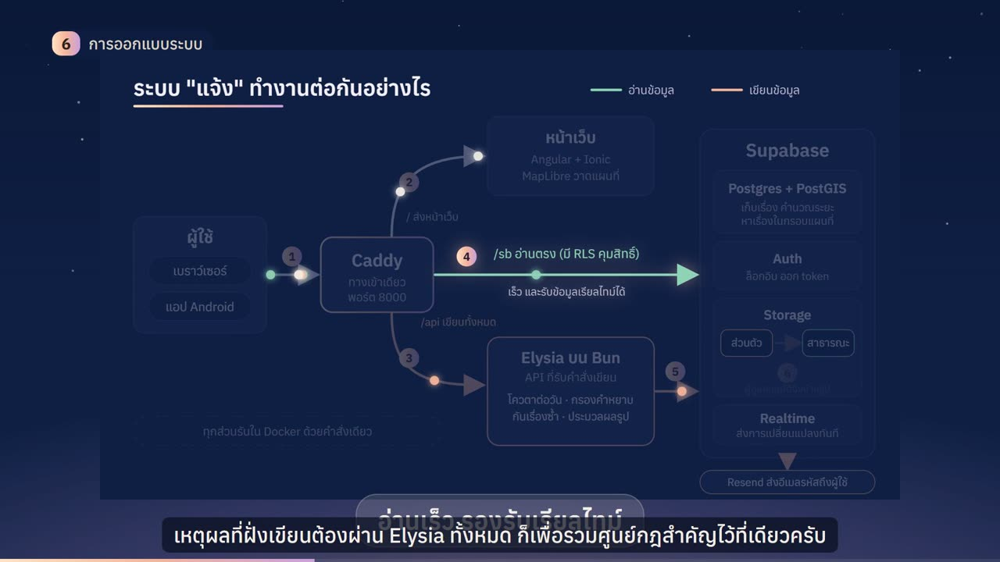
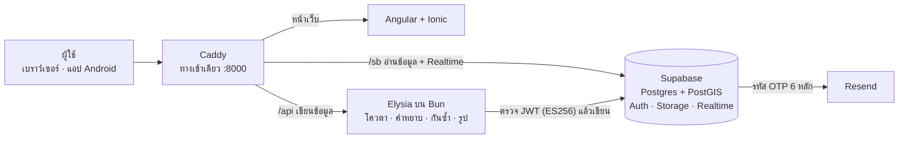

<div align="center">

# แจ้ง · Jaeng

**เว็บแอปแจ้งและติดตามปัญหาในชุมชนบนแผนที่ประเทศไทยแบบเรียลไทม์**<br>
*A real-time, map-based web & Android app for reporting and tracking community issues in Thailand*

[](apps/web)
[](apps/web)
[](apps/api)
[](supabase)
[](apps/web)
[](scripts/build-apk.sh)
[](LICENSE)

<a href="docs/media/jaeng-presentation.mp4">
  
</a>

**▶ [ดูคลิปนำเสนอ (12:43 · 1080p 60 fps · ภาษาไทย มีซับในภาพ)](docs/media/jaeng-presentation.mp4)**

</div>

---

ทุกเรื่องที่แจ้งจะขึ้นบนแผนที่ประเทศไทยเป็น **ลำแสง** แบบ Bat-Signal สีและรูปทรงบอกระดับอันตราย ความสูงบอกว่ามีคนเจอเหมือนกันกี่คน คนในละแวกกด **"เจอเหมือนกัน"** แสดงความคิดเห็น และติดตามได้ว่าเรื่องนั้นแก้แล้วหรือยัง

ชื่อ "แจ้ง" แปลได้ทั้ง *แจ้งเรื่อง* และ *สว่าง*

> **English summary.** Jaeng lets residents report local problems (broken roads, dead street lights, blocked drains, rubbish) in three steps: photo, category, location. Every approved report rises on a map of Thailand as a light beam whose colour and shape show severity and whose height grows as neighbours tap "I see it too". Moderators approve reports before they go public, residents report fixes, and every screen updates in real time. Built with Angular + Ionic + Capacitor, Elysia on Bun, Supabase (Postgres, PostGIS, Auth, Storage, Realtime) and MapLibre GL. The UI is in Thai and English.

## สารบัญ

- [ภาพจากแอป](#ภาพจากแอป)
- [ความสามารถ](#ความสามารถ)
- [สถาปัตยกรรม](#สถาปัตยกรรม)
- [เทคโนโลยี](#เทคโนโลยี)
- [โครงสร้างโปรเจกต์](#โครงสร้างโปรเจกต์)
- [เริ่มใช้งาน](#เริ่มใช้งาน)
- [การทดสอบและผลลัพธ์](#การทดสอบและผลลัพธ์)
- [ความเป็นส่วนตัวและความปลอดภัย](#ความเป็นส่วนตัวและความปลอดภัย)
- [ข้อจำกัดและแผนต่อยอด](#ข้อจำกัดและแผนต่อยอด)
- [คลิปนำเสนอทำด้วยโค้ด](#คลิปนำเสนอทำด้วยโค้ด)
- [เอกสาร](#เอกสาร)
- [ร่วมพัฒนา](#ร่วมพัฒนา)
- [เครดิตและไลเซนส์](#เครดิตและไลเซนส์)

## ภาพจากแอป

| แผนที่และลำแสง | แจ้งเรื่องบนมือถือ |
|---|---|
|  |  |
| **เรียลไทม์: ผู้แจ้ง ผู้ดูแล เพื่อนบ้าน อัดพร้อมกัน 3 จอ** | **แผนผังระบบ** |
|  |  |

ภาพทั้งหมดมาจากคลิปนำเสนอ ซึ่งอัดจากแอปที่รันจริงบนข้อมูลเดโม

## ความสามารถ

**แผนที่และลำแสง**
- แผนที่ประเทศไทยด้วย MapLibre GL ซูมได้ตั้งแต่ทั้งประเทศจนถึงระดับถนน
- ระดับอันตราย 4 ระดับ (ทั่วไป · ควรระวัง · อันตราย · วิกฤต) ต่างกันทั้งสี รูปทรง และจังหวะกะพริบ ไม่ใช้สีอย่างเดียวบอกความหมาย (WCAG)
- ความสูงของลำแสงโตตามจำนวนคนที่กด "เจอเหมือนกัน"
- สถานะดูจากรูปร่างของลำแสง: ยังไม่แก้เป็นลำแสงเต็มพร้อมป้ายว่าค้างมากี่วัน, มีคนแจ้งว่าแก้แล้วลำแสงจะจางลง, ผู้ดูแลยืนยันแล้วลำแสงดับเหลือเครื่องหมายถูก
- ซูมออกแล้วลำแสงรวมเป็นวงตัวเลข ซูมเข้าแล้วแยกเป็นลำแสงทีละเรื่อง พร้อมป้ายชื่อ
- ค้นหาจากหัวข้อ แท็ก และชื่อสถานที่ (ภาษาไทยใช้ `pg_trgm`) กรองตามระดับหรือหมวดได้ และมีหน้ารายการเรียงได้ 4 แบบ

**แจ้งเรื่องใน 3 ขั้น**
- ถ่ายรูป → เลือกหมวด (8 หมวด ไอคอนใหญ่) → ยืนยันตำแหน่ง → ส่ง
- ใส่รูปได้สูงสุด 4 รูป ระบบหาตำแหน่งจากพิกัดในรูปก่อน ถ้าไม่มีใช้ GPS ของเครื่อง และลากหมุดปรับเองได้
- กันเรื่องซ้ำ: ถ้ามีเรื่องหมวดเดียวกันในรัศมี 50 เมตร จะถาม "เรื่องนี้ใช่ไหม" ให้กด "เจอเหมือนกัน" แทนได้
- ช่องเสริมพับเก็บไว้ ได้แก่ หัวข้อ คำอธิบาย แท็ก และสวิตช์ไม่แสดงชื่อ

**ชุมชนและการติดตาม**
- กด "เจอเหมือนกัน" แสดงความคิดเห็นพร้อมแนบรูป และทุกเรื่องมีลิงก์ของตัวเอง
- แจ้งว่าแก้แล้วพร้อมรูปหลังแก้ ให้ผู้ดูแลเทียบรูปก่อนกับหลังแล้วยืนยัน
- ระบบไม่ปิดเรื่องเองอัตโนมัติ เรื่องที่ยังไม่แก้จะยังค้างให้ทุกคนเห็น
- อัปเดตสดผ่าน Supabase Realtime: ลำแสงบนจอคนอื่นเปลี่ยนเองโดยไม่ต้องรีเฟรช ถ้าส่วนเรียลไทม์ล่ม แผนที่ยังใช้งานได้

**บัญชีและผู้ดูแล**
- ไม่มีรหัสผ่าน: กรอกอีเมลแล้วใส่รหัส 6 หลักที่ส่งผ่าน Resend ระบบสมัครกับล็อกอินเป็นขั้นตอนเดียวกัน
- ผู้ใช้ใหม่ตั้งชื่อเล่น (มีตัวกรองคำหยาบ) และรูปโปรไฟล์ได้
- มี 3 บทบาท: ผู้เยี่ยมชม · สมาชิก · ผู้ดูแล
- หน้าผู้ดูแลมี 5 แท็บ: รอตรวจ · แจ้งว่าแก้แล้ว · ถูกรายงาน · ผู้ใช้ · บันทึก ทุกการกระทำถูกบันทึกไว้
- ควบคุมคุณภาพ: แจ้งได้ 5 เรื่องต่อวันต่อคน, ถ้าสมาชิก 3 คนรายงานเนื้อหาเดียวกันจะซ่อนไว้รอผู้ดูแลตัดสิน, ผู้ดูแลแบนบัญชีหรือลบรูปโปรไฟล์ได้
- เรื่องระดับวิกฤตมีกล่องเตือนว่าแอปนี้ไม่ใช่ช่องทางแจ้งเหตุฉุกเฉิน พร้อมเบอร์ 191 · 199 · 1669

**ใช้ได้ทุกที่**
- เว็บแบบติดตั้งได้ (PWA) และแอป Android (Capacitor) ที่ใช้ GPS และกล้องของเครื่อง
- ไทย ⇄ English สลับได้ทันที ภาษาไทยแสดงปีเป็น พ.ศ. มีธีมมืดและสว่าง

## สถาปัตยกรรม



- **ทางเข้าเดียว:** ทุกคำขอผ่าน Caddy ที่พอร์ตเดียว จึงไม่มีปัญหา CORS และ WebSocket ของ Realtime ผ่านได้
- **อ่านตรง เขียนผ่าน API:** ฝั่งอ่านยิงตรงไปที่ Supabase โดยมี Row Level Security คุม ทำให้อ่านเร็วและรับข้อมูลเรียลไทม์ได้ ส่วนฝั่งเขียนต้องผ่าน Elysia ทั้งหมด เพื่อให้กฎสำคัญอยู่ที่เดียว ได้แก่ โควตาต่อวัน การกรองคำหยาบ การกันเรื่องซ้ำ และการจัดการรูป
- **รูปเป็นส่วนตัวจนกว่าจะอนุมัติ:** รูปเก็บใน bucket ส่วนตัวก่อน พอผู้ดูแลอนุมัติแล้วจึงย้ายไป bucket สาธารณะ

รายละเอียดทั้งหมดอยู่ใน [เอกสารออกแบบ](docs/superpowers/specs/2026-10-16-jaeng-design.md) หัวข้อ 4 ถึง 7

## เทคโนโลยี

| ส่วน | ใช้ | ทำไม |
|---|---|---|
| หน้าบ้าน | Angular 22 + Ionic 9 | หน้าตาแบบแอปมือถือ (แผ่นล่าง หน้าต่าง ปุ่มลอย) จากโค้ดเว็บชุดเดียว |
| แอปมือถือ | Capacitor | ได้ APK จากโค้ดเดียวกัน เรียก GPS และกล้องผ่านปลั๊กอินเนทีฟ |
| แผนที่ | MapLibre GL + OpenFreeMap | ฟรี ไม่ต้องใช้คีย์ ซูมได้ตั้งแต่ทั้งประเทศจนถึงถนน ลำแสงวาดเป็นเลเยอร์ของตัวเอง |
| API | Elysia บน Bun + TypeBox | เร็ว (ค่ากลางราว 2 ms) และตรวจชนิดข้อมูลด้วย TypeScript |
| ข้อมูล | Supabase: Postgres, PostGIS, `pg_trgm`, Auth, Storage, Realtime | รวมทุกอย่างไว้ชุดเดียว รันบนเครื่องได้ฟรี PostGIS ใช้คำนวณระยะ ส่วน `pg_trgm` ใช้ค้นภาษาไทย |
| โครงสร้าง | Caddy, Docker Compose ใน WSL2 | `bash scripts/dev-up.sh` คำสั่งเดียวขึ้นทั้งสแตก |
| อีเมล | Resend (SMTP) / Mailpit ตอนพัฒนา | ส่งรหัส OTP ถึงกล่องจดหมายจริง |
| ทดสอบ | Vitest, `bun test`, pgTAP, Playwright | ครอบคลุมทุกชั้น ตั้งแต่โค้ดส่วนกลางถึงฐานข้อมูลและ E2E |

## โครงสร้างโปรเจกต์

```
apps/
  web/        Angular + Ionic + Capacitor: core/ (บริการ, guard), features/ (map, report-new,
              report-detail, auth, me, admin), shared/, theme/ ไฟล์ *.spec.ts อยู่ข้างโค้ด
  api/        Elysia บน Bun: routes/, photos/ (pipeline, privacy, storage), moderation/; เทสต์ใน test/
packages/
  shared/     ชนิดข้อมูลและตรรกะที่ใช้ทั้งสองแอป (report, levels, beam, categories ...)
supabase/     migrations/, pgTAP tests/, seed/, config.toml
scripts/      ทุกงานพัฒนา: dev-up, dev-down, test, reset-db, build-web, build-apk, tunnel ...
infra/        Caddyfile และ Dockerfile สำหรับ build APK
e2e/          Playwright: ฉากเดโมเต็มเรื่องและการวัดความเร็ว
video/        คลิปนำเสนอที่สร้างด้วยโค้ด (Remotion) ดู video/README.md
docs/         เอกสารออกแบบ แผนงาน ต้นแบบ และสคริปต์คลิป
```

## เริ่มใช้งาน

สแตกทั้งหมดรันใน **WSL2 (Ubuntu) + Docker** ทุกคำสั่งรันในโฟลเดอร์โปรเจกต์ (เช่น `/mnt/d/Project/Jaeng`) และต้องใช้ Node ของ Linux ใน WSL ไม่ใช่ Node ของ Windows

### ติดตั้งครั้งแรก

1. ติดตั้ง Node 22 ของ Linux ไว้ที่ `~/.local/node` แล้วเพิ่ม `export PATH="$HOME/.local/node/bin:$PATH"` ใน `~/.bashrc`
2. ติดตั้ง Docker Compose v2+ เป็น CLI plugin (หรือ `sudo apt install docker-compose-v2`)
3. รัน `npm install` เพื่อติดตั้ง Supabase CLI ในโปรเจกต์
4. รัน `bash scripts/check-tools.sh` แล้วต้องขึ้น ✓ ทุกบรรทัด

### รันทุกวัน

```bash
bash scripts/dev-up.sh     # เปิดสแตก
bash scripts/dev-down.sh   # ปิดสแตก
bash scripts/reset-db.sh   # ล้างฐานข้อมูลแล้วใส่ข้อมูลเดโม 40 เรื่องใหม่
```

| บริการ | ที่อยู่ |
|---|---|
| แอป | http://localhost:8000 |
| หน้าผู้ดูแล | http://localhost:8000/admin |
| Mailpit (อีเมล OTP ตอนพัฒนา) | http://localhost:54324 |
| Supabase Studio (ปิดไว้ เปิดที่ `[studio] enabled` ใน `supabase/config.toml`) | http://localhost:54323 |

**บัญชีเดโม:** `admin@jaeng.local` (ผู้ดูแล), `reporter@jaeng.local` และ `neighbor1@jaeng.local` ถึง `neighbor40@jaeng.local` ทุกบัญชีใช้รหัสผ่าน `DEMO_PASSWORD` ใน `.env` ซึ่ง `scripts/gen-env.sh` สุ่มให้ต่อเครื่อง ถ้าสุ่มรหัสใหม่ ให้รัน `bash scripts/reset-db.sh` หนึ่งครั้ง ค่าตั้งอื่นดูได้ที่ [`.env.example`](.env.example) เช่น โควตาต่อ 24 ชั่วโมง `RATE_LIMIT_*`

<details>
<summary><b>อีเมลรหัสเข้าใช้ (Resend / Mailpit)</b></summary>

รหัส OTP ส่งผ่าน Resend ตั้งไว้ใน `[auth.email.smtp]` ของ `supabase/config.toml` คีย์อยู่ใน `supabase/.env` ที่บรรทัด `RESEND_API_KEY=...` (ไฟล์นี้อยู่ใน `.gitignore`) ถ้าจะใช้โดเมนของตัวเอง ให้แก้ผู้ส่งใน `config.toml`

ตอนพัฒนาไม่อยากส่งอีเมลจริง ให้สลับไปใช้ Mailpit:

```bash
bash scripts/mail-mode.sh mailpit   # หรือ resend, status
bash scripts/dev-up.sh
```

แผนฟรีของ Resend ส่งได้วันละ 100 ฉบับ และ `[auth.rate_limit] email_sent` จำกัดไว้ 100 ฉบับต่อชั่วโมง ควรเพิ่มเรกคอร์ด DMARC ที่ DNS ของโดเมน ไม่งั้นอีเมลอาจตกสแปม
</details>

<details>
<summary><b>แอปแบบติดตั้งได้ (PWA)</b></summary>

dev server ที่พอร์ต 8000 ไม่มี service worker ถ้าจะลองแบบติดตั้งได้หรือเปิดตอนออฟไลน์ ให้ build ก่อน:

```bash
bash scripts/build-web.sh
```

แล้วเปิด http://localhost:8100 ซึ่ง Caddy เสิร์ฟ `apps/web/www` และส่ง `/api` กับ `/sb` ต่อแบบเดียวกับพอร์ต 8000 พอ build ใหม่ แอปที่เปิดค้างอยู่จะขึ้น "มีเวอร์ชันใหม่" ให้กด การค้นหาสถานที่ใช้ชื่ออำเภอและจังหวัดในเครื่องก่อน ถ้าไม่เจอจึงถาม OpenStreetMap Nominatim
</details>

<details>
<summary><b>แอป Android (APK) ผ่าน Cloudflare quick tunnel</b></summary>

แอปเดียวกับเว็บ ห่อด้วย Capacitor ต่อเซิร์ฟเวอร์บนคอมผ่านที่อยู่ https สาธารณะของ Cloudflare quick tunnel (ไม่ต้องอยู่ Wi-Fi เดียวกัน `cloudflared` รันจาก Docker image)

```bash
bash scripts/build-web.sh   # ครั้งแรก หรือเมื่อแก้เว็บ
bash scripts/tunnel.sh      # พิมพ์ที่อยู่ https://<สุ่ม>.trycloudflare.com ปิดด้วย Ctrl+C
bash scripts/build-apk.sh   # ได้ dist/jaeng-debug.apk
bash scripts/check-apk.sh
```

- ที่อยู่ของอุโมงค์เปลี่ยนทุกครั้งที่เปิด จึงไม่ต้อง build ใหม่: เปิดแอป → ตั้งค่าเซิร์ฟเวอร์ → ใส่ที่อยู่ใหม่ → ทดสอบ → บันทึก
- ระหว่างที่อุโมงค์เปิด พอร์ต `:8100` ทั้งหมดอยู่บนอินเทอร์เน็ต สคริปต์จะปิดปุ่มสลับผู้ใช้เดโมให้เองแล้วคืนค่าเมื่อปิดอุโมงค์
- build ครั้งแรกนาน เพราะต้องโหลด Android SDK และ Gradle อย่ารันพร้อม `test.sh` เพราะ WSL มีแรมจำกัด

| อาการ | ตรวจ |
|---|---|
| `tunnel.sh` บอกว่าไม่มี production build | รัน `bash scripts/build-web.sh` ก่อน |
| "ทดสอบ" ในหน้าตั้งค่าเซิร์ฟเวอร์ไม่ผ่าน | ที่อยู่ของอุโมงค์เก่าแล้ว ให้เปิดใหม่แล้วใส่ที่อยู่ใหม่ ลองเปิด `/api/health` ในเบราว์เซอร์มือถือ |
| ปุ่มตำแหน่งหรือกล้องไม่ทำงาน | ตั้งค่า Android → แอป → แจ้ง → สิทธิ์ แล้วเปิด GPS ของเครื่อง |
| ล็อกอินไม่ได้ | ในโหมด Mailpit รหัส OTP อยู่ที่ Mailpit บนคอม รหัสใช้ได้ 1 ชั่วโมง |
</details>

## การทดสอบและผลลัพธ์

```bash
bash scripts/test.sh   # รันครบ 7 ชุด
```

| ชุด | จำนวน |
|---|---|
| โค้ดส่วนกลาง (`packages/shared`) | 20 เทสต์ |
| API (`bun test`) | 386 เทสต์ |
| เว็บ (Vitest ใน container) | 1,024 เทสต์ |
| ฐานข้อมูล (pgTAP) | 579 รายการ |
| ข้อมูลตัวอย่าง · API บนระบบจริง · กรณีแย่งกันส่งความคิดเห็น | ผ่าน |

ผลวัดบนเครื่องเดียว กับข้อมูลเดโม 40 เรื่อง:

- ดึงลำแสงทั่วประเทศ (`reports_in_bbox`) 90 ครั้ง ได้ค่ากลาง **7 ms** ช้าสุด **61 ms**
- API ที่ไม่แตะฐานข้อมูล วัด 1,500 ครั้ง ได้ค่ากลางราว **2 ms**
- ลำแสงบนจอเพื่อนบ้านเปลี่ยนเองภายใน **873 ms** หลังผู้ดูแลกดอนุมัติ (วัดครั้งเดียว)

ตัวเลขนี้ยังไม่ใช่ผลภายใต้โหลดของผู้ใช้จริง

## ความเป็นส่วนตัวและความปลอดภัย

- ลบพิกัด (EXIF) ออกจากรูป 2 ชั้น คือบนเบราว์เซอร์ และซ้ำอีกครั้งที่ API
- รูปเก็บในพื้นที่ส่วนตัวจนกว่าผู้ดูแลจะอนุมัติ
- หมวดจุดเสี่ยงจะสุ่มเลื่อนพิกัดที่แสดงไม่เกิน 150 เมตร เพื่อไม่ให้ชี้บ้านหรือตัวผู้แจ้ง
- ฝั่งอ่านคุมด้วย Row Level Security และ API ตรวจ JWT ด้วยกุญแจสาธารณะ (ES256)
- ใช้โควตาต่อวันและตัวกรองคำหยาบ เนื้อหาที่ถูกรายงานครบ 3 คนจะถูกซ่อนไว้รอผู้ดูแล
- สวิตช์ไม่แสดงชื่อซ่อนชื่อและรูปผู้แจ้งจากคนอื่น แต่หลังบ้านยังรู้ว่าใครส่ง

พบช่องโหว่ด้านความปลอดภัย กรุณาแจ้งเจ้าของ repo เป็นการส่วนตัวก่อนเปิดเผย

## ข้อจำกัดและแผนต่อยอด

**ยังไม่ทำ** (จึงยังไม่เปิดให้คนทั่วไปใช้):
- เบลอใบหน้าและป้ายทะเบียนในรูปอัตโนมัติ (ต้องทำก่อนเปิดสาธารณะ ตามหลัก PDPA)
- ขึ้นเซิร์ฟเวอร์จริง ตอนนี้รันบนเครื่องเดียว
- แจ้งเตือนแบบ Push
- เชื่อมข้อมูลกับหน่วยงานจริง เช่น เทศบาล
- ล็อกอินด้วย LINE หรือ Google

**แผนต่อยอด:** ทำระบบเบลอให้เสร็จ → เปิดให้ลองผ่านอินเทอร์เน็ต → แจ้งเตือนเมื่อเรื่องที่ติดตามถูกแก้ → ล็อกอินด้วย LINE → แบ่งผู้ดูแลตามพื้นที่

## คลิปนำเสนอทำด้วยโค้ด

[คลิปนำเสนอ](docs/media/jaeng-presentation.mp4) สร้างทั้งหมดด้วยโค้ดในโฟลเดอร์ [`video/`](video):

- **ภาพ:** [Remotion](https://www.remotion.dev) (React) 1080p 60 fps ทุกฉากซิงก์กับคำพูดจริง
- **เดโม:** อัดจากแอปที่รันจริงด้วย Playwright และมือถือ Android จริงผ่าน scrcpy
- **เสียงพูด:** ถอดเสียงและหาเวลาของแต่ละคำด้วย ElevenLabs Scribe แล้วตัดช่วงเงียบ
- **ดนตรีพื้นหลัง:** สังเคราะห์ด้วย Python (NumPy/SciPy) ระดับพลังงานเปลี่ยนตามอารมณ์ของแต่ละฉาก
- **ซับไตเติล:** สร้างจากสคริปต์ที่จับคู่กับเวลาคำพูด

วิธีสร้างใหม่ดูที่ [`video/README.md`](video/README.md) ส่วนไฟล์เสียงอัด คลิปดิบ และไฟล์กลางไม่ได้อยู่ใน repo

## เอกสาร

- [เอกสารออกแบบ (Design Spec)](docs/superpowers/specs/2026-10-16-jaeng-design.md) เป็นแหล่งอ้างอิงหลักของทุกเรื่อง
- [แผนภาพรวม (Roadmap)](docs/superpowers/plans/2026-10-16-00-roadmap.md) และแผนรายส่วนใน [`docs/superpowers/plans/`](docs/superpowers/plans)
- [DESIGN.md](DESIGN.md) ระบบออกแบบ UI · [PRODUCT.md](PRODUCT.md) ข้อมูลผลิตภัณฑ์
- [ต้นแบบหน้าตาแผนที่ไทย](docs/prototype/thai-map-v2.html) เปิดในเบราว์เซอร์ได้เลย
- [สคริปต์คลิปนำเสนอ](docs/video/script-th.md) พร้อมที่มาของตัวเลขทุกตัว
- `docker-webui/` เป็นเครื่องมือจัดการ Docker ใน WSL ผ่านเว็บ (พอร์ต 8080) แยกจากแอปนี้

## ร่วมพัฒนา

ยินดีรับ issue และ pull request:

1. Fork แล้วแตก branch จาก `master`
2. แก้ให้อยู่ในขอบเขตของเรื่องเดียว และเพิ่มเทสต์ข้างโค้ดที่แก้
3. `bash scripts/test.sh` ต้องผ่านครบ ถ้าแก้ migration ให้รัน `bash scripts/gen-types.sh` (ห้ามแก้ `packages/shared/database.types.ts` เอง)
4. เขียน commit แบบ Conventional Commits เช่น `feat(web): ...`, `fix(api): ...`

## เครดิตและไลเซนส์

- แผนที่: © [OpenStreetMap](https://www.openstreetmap.org/copyright) contributors ผ่าน [OpenFreeMap](https://openfreemap.org)
- ขอบเขตจังหวัดและอำเภอ: OCHA COD-AB Thailand (`cod-ab-tha` บน HDX, CC BY-IGO)
- ค้นหาสถานที่: OpenStreetMap Nominatim
- เอฟเฟกต์เสียงและการถอดเสียงในคลิป: [elevenlabs.io](https://elevenlabs.io)

พัฒนาโดย **อัสนีย์ วงศ์สุวรรณ** ([@BKungBK](https://github.com/BKungBK))

โค้ดเผยแพร่ภายใต้ [MIT License](LICENSE) ส่วนคลิปนำเสนอและข้อมูลแผนที่เป็นไปตามเงื่อนไขของแหล่งที่มาข้างต้น (เอฟเฟกต์เสียงในคลิปมาจากแผนฟรีของ ElevenLabs จึงห้ามใช้คลิปเชิงพาณิชย์)
